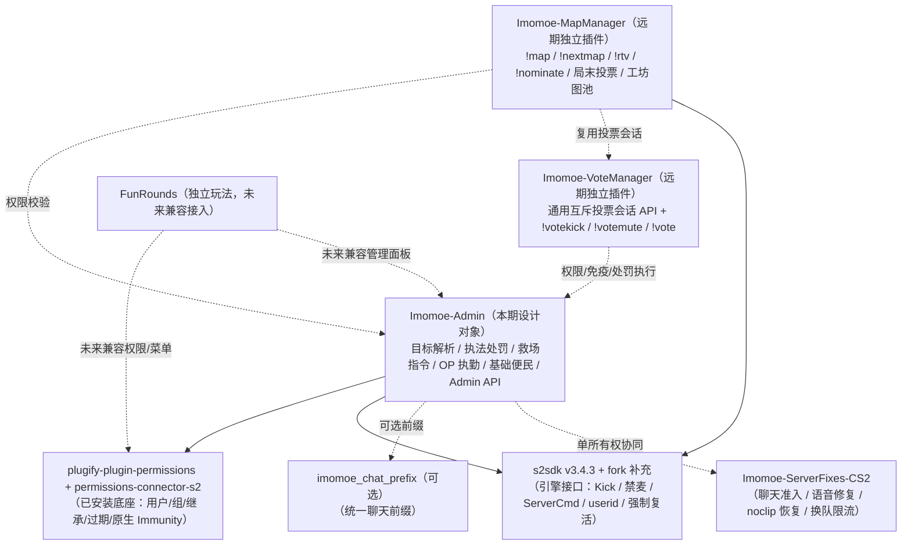

# Imomoe-Admin 需求与架构规格说明书 / Specification

[简体中文](#简体中文) | [English](#english)

---

## 简体中文

> **文档状态**：一期需求基线；构建与接入入口见 [README](../README.md)。  
> **仓库与插件**：`Imomoe-Admin`（Plugify 插件名 `imomoe_admin`，见 [`imomoe_admin.pplugin`](../imomoe_admin.pplugin)）。  
> **定位**：完全独立运行的 CS2 通用服务器管理与基础便民插件，不强依赖 `FunRounds`；未来由 `FunRounds`、`Imomoe-MapManager` 与 `Imomoe-VoteManager` 可选接入本插件及 `plugify-plugin-permissions`。

---

### 一、生态定位与插件族命名

整个 Imomoe CS2 管理与社区套件按 SourceMod「小而专」思路拆分为松耦合的独立 Plugify 插件：

#### 远期规划插件分工
- **`Imomoe-MapManager`**：全权负责地图管理，包括管理员手动换图（`imomoe_map` / `!map`、`imomoe_nextmap` / `!nextmap`）、标准图与工坊图池（`changelevel` / `ds_workshop_changelevel` / `host_workshop_map`）、`!rtv` / `!nominate` / 局末投票与地图冷却。**本期 `Imomoe-Admin` 不包含任何换图命令。**
- **`Imomoe-VoteManager`**：全权负责通用投票会话引擎（全服互斥投票队列、防刷冷却、比例裁决、对外投票 API），并内置玩家投票踢出/静音（`!votekick`、`!votemute`）及 OP 自定义投票（`!vote`），通过 `Imomoe-Admin` 校验权限/免疫并执行处罚结果。**本期仅作架构留白，暂不实现。**

---

### 二、一期核心设计：`Imomoe-Admin`

#### 2.1 权限与免疫体系（基于最新版 `plugify-plugin-permissions`）

1. **直接复用 `plugify-plugin-permissions` + `permissions-connector-s2`**：
   - 最新版 `plugify-plugin-permissions` 已原生提供：
     - 用户、分组、父组继承与优先级（Priority）；
     - 节点通配符（如 `imomoe.admin.*`）与权限过期时间；
     - **原生免疫值（Immunity）**：支持为玩家或组配置免疫度（`-1` 继承最高组优先级），执行者免疫度须 `>=` 目标免疫度；
     - `permissions-storage`（默认本地 SQLite `permissions.db`）与 `perms_*` 维护命令。
   - **本插件职责**：`imomoe_admin.pplugin` 声明依赖 `permissions`（启动与热加载时基于服务器实际 `.pplugin` 生成强类型绑定），不重复造第二套用户/组权限存储。
   - **依赖构建**：离线用户加载使用 [permissions-storage 资料保留补丁](../integration/permissions-storage-offline-profile.patch)（已验证 SQLite）。Windows 环境下，`permissions-connector-s2`（1.0.0）与 `permissions-storage`（1.0.2）同载需使用包含 [Go 上游 TLS 修复 `35b807d`](https://github.com/golang/go/commit/35b807d) 的 Go 1.28+ 构建，避免争用 `ArbitraryUserPointer`。
2. **仅在本插件内补充管理侧策略**：
   - 目标自指开关（如是否允许对自己使用 `!slap`/`!respawn`/`!noclip`）；
   - RCON / 服务端控制台始终拥有最高权限与最高免疫，不受玩家免疫限制；
   - 权限节点命名空间统一使用 **`imomoe.admin.<action>`**（如 `imomoe.admin.ban`、`imomoe.admin.kick`、`imomoe.admin.cvar`、`imomoe.admin.teleport`）。

#### 2.2 目标选择器（Target Resolver）

统一在纯 Rust Core 中实现，所有带 `<目标>` 参数的指令共享同一套解析与安全过滤：
- **单目标匹配**：
  - 17 位 SteamID64（`7656119...`，离线指令如 `imomoe_addban` / `imomoe_unban` 强制要求）；
  - `#userid` 或 `#slot`；
  - 昵称子串模糊匹配（不区分大小写；若命中 ≥2 名在线玩家，**拒绝执行**并列出匹配候选，防止误执法）。
- **集合选择器**（按命令标记 `allow_multi_target` 控制开放范围，高危指令如 `imomoe_ban` 默认禁用群选）：
  - `@me`（自己）、`!@me`（除自己外所有人）、`@all`、`@t`、`@ct`、`@spec`、`@alive`、`@dead`、`@bots`、`@humans`。
- **免疫拦截**：集合展开或单目标匹配后自动比对免疫度，跳过/拒绝高免疫目标并向执行者输出清晰反馈。

#### 2.3 配置与持久化存储

1. **JSONC 配置 + JSON Schema**：
   - 沿用 `Imomoe-Server-Sounds` 规范，使用 `jsonc-parser` + `serde_json`，配置置于 `configs/imomoe_admin/` 并附带 `schemas/`：
     - `admin.jsonc`：存储驱动选择、默认惩罚时长、隐身执勤设置、ConVar 白名单、举报冷却与日志开关；
     - `announcements.jsonc`：定时滚动公告条目、发送周期、`!rules` / `!help` 文本配置；
     - `translations/*.jsonc`：按 `GetClientLanguageCode` 渲染的双语（`zh-CN` / `en`）文案。
   - 校验配置结构、必需词条及非空文本；支持注释和尾随逗号。运行时另检查相对 SQLite 路径是否符合宿主路径规则、默认时长是否可用秒数表示。
2. **可选 SQLite + 本地 JSON 文件降级（未来可扩展 MySQL）**：
   - Core 抽象 `PunishmentStore` trait，Adapter 提供两种内置驱动：
     - **SQLite（推荐）**：`"storage": { "driver": "sqlite", "path": "data/imomoe_admin.db" }`，记录有效与历史 Ban/Mute/Gag 与基础审计索引；
     - **本地文件降级（未启用 SQLite 时）**：`"driver": "file"`，将仍在有效期内的封禁与通信处罚分别持久化到 `data/bans.json` 与 `data/comms.json`，采用**同目录临时文件 + 原子替换**，保证关闭 SQLite 时重开服务器依然生效。
   - **远期 MySQL**：后续多服共享封禁时只需新增异步 MySQL `PunishmentStore` 实现，不改动业务命令层。

#### 2.4 一期命令矩阵（控制台统一 `imomoe_` 前缀）

> **命名约定**：控制台命令统一 `imomoe_<action>`（如 `imomoe_ban`）；聊天触发统一支持 `!` / `/` 短指令（如 `!ban`、`!kick`）。时长参数统一支持 `0`（永久）、`10m`、`2h`、`7d`、`1w`。

| 分类 | 控制台命令 | 聊天快捷指令 | 功能与边界说明 | 默认权限节点 |
| :--- | :--- | :--- | :--- | :--- |
| **踢出与封禁** | `imomoe_kick` `imomoe_ban` `imomoe_addban` `imomoe_unban` `imomoe_banlist` | `!kick` `!ban` `!addban` `!unban` `!banlist` | 按原生原因码踢出；在 Steam 身份验证回调检查有效封禁并断开。自定义原因供服务端诊断，封禁原因与到期时间可由管理命令查询；客户端沿用 CS2 原生提示。支持离线 SteamID64 补封、解封与分页查询。 | `imomoe.admin.kick` `imomoe.admin.ban` `imomoe.admin.unban` |
| **通信管控** | `imomoe_mute` / `imomoe_unmute` `imomoe_gag` / `imomoe_ungag` `imomoe_silence` / `imomoe_unsilence` `imomoe_comms` | `!mute` / `!unmute` `!gag` / `!ungag` `!silence` / `!unsilence` `!comms` | `mute` 禁麦（语音监听屏蔽）、`gag` 禁言（文字聊天拦截）、`silence` 同时禁用；支持限时与持久化；`!comms` 允许玩家自查当前限制与剩余时间。 | `imomoe.admin.mute` `imomoe.admin.gag` |
| **玩家救场与调队** | `imomoe_slay` `imomoe_slap` `imomoe_team` `imomoe_swap` `imomoe_respawn` `imomoe_tp` / `imomoe_bring` / `imomoe_goto` `imomoe_freeze` / `imomoe_unfreeze` `imomoe_noclip` | `!slay` `!slap` `!team` `!swap` `!respawn` `!tp` / `!bring` / `!goto` `!freeze` / `!unfreeze` `!noclip` | 处死、轻拍（可选伤害）、强行切队/换边、强制复活、传送拉人/前往、冻结与飞行；`freeze`/`noclip` 绑定玩家当前生命与连接，在死亡/换图/断线/卸载时自动回收插件持有的状态。 | `imomoe.admin.slay` `imomoe.admin.team` `imomoe.admin.respawn` `imomoe.admin.teleport` `imomoe.admin.cheat` |
| **OP 执勤工具** | `imomoe_who` `imomoe_hide` `imomoe_adminchat` | `!who` `!hide` `!a <消息>` 或 `say_team @<消息>` | `!who` 查看在线管理与权限；`!hide` 切换匿名执法（全服提示隐藏 OP 昵称，且 `!admins` 不可见）；`@` 管理内聊仅在线 OP 接收。 | `imomoe.admin.who` `imomoe.admin.hide` `imomoe.admin.chat` |
| **对局与安全代理** | `imomoe_restart` `imomoe_pause` / `imomoe_unpause` `imomoe_cvar` `imomoe_reload` | `!restart` `!pause` / `!unpause` `!cvar` `!iareload` | `restart`/`pause` 控制当前对局；`cvar` 仅允许读写 `admin.jsonc` 中配置的安全白名单 ConVar；`reload` 热重载 JSONC 配置与公告。 | `imomoe.admin.match` `imomoe.admin.cvar` `imomoe.admin.reload` |
| **社区基础便民** | `imomoe_admins` `imomoe_report` `imomoe_rules` `imomoe_help` | `!admins` `!report` / `say @<内容>` `!rules` `!help` | `!admins` 列出在线非隐身 OP；`!report` 与玩家 `say @` 实时转发在线 OP 内聊并记录 `data/reports.log`；定时聊天公告与命令/规则说明支持可选接入 `imomoe_chat_prefix`。 | 公开可用（`!report` 设防刷冷却） |

#### 2.5 对外暴露的 Plugify API（供 `MapManager` / `VoteManager` / 未来 `FunRounds` 调用）

在 `imomoe_admin.pplugin` 中导出跨插件方法：
- **状态查询**：`IsClientMuted(slot) -> bool`、`IsClientGagged(slot) -> bool`、`IsAdminHidden(slot) -> bool`
- **免疫与目标辅助**：`CanTarget(actorSlot, targetSlot) -> bool`
- **处罚代理**：`KickClient(slot, reason)`、`ApplyBan(actorSlot, targetSlot, minutes, reason)`、`ApplyMute(actorSlot, targetSlot, minutes, reason)`
- **管理通知**：`NotifyAdmins(message)`
- **ServerFixes 协同**：`OwnsClientNoclip(slot, pawnHandle) -> bool`，只对 Admin 仍持有的完整 pawn handle 返回 true。
- **二期菜单扩展口**：预留 `RegisterMenuCategory` / `RegisterMenuItem` 机制，便于未来 `FunRounds` 与 `Imomoe-MapManager` 挂入 `!admin` 或复用菜单框架。

---

### 三、引擎接口补齐与跨插件协同边界

#### 3.1 一期 S2SDK 依赖与二期接口

1. **[原版 v3.4.3](https://github.com/untrustedmodders/plugify-plugin-s2sdk/blob/v3.4.3/plugify-plugin-s2sdk.pplugin.in)**：`KickClient` 用原生原因码断连，消息用于服务端诊断；`GetClientListening` / `SetClientListening` 读写听者与发言者之间的语音覆盖；`ServerCommand` 执行固定的对局控制命令。
2. **一期 fork 补充**：`GetClientUserID` 供 `#userid:` 查找真实引擎 ID（将来迁入共享 C++ 底座）；`ForceRespawnClient` 供复活命令使用。
3. **二期菜单实验所需**：
   - `CCSCustomHudLayout` 布局下发、每玩家覆写及 Panel 状态更新接口；
   - `SetInputCaptureEnabled(slot, enabled)` 与 `CS_UM_CustomHudClicked` 点击回调桥接。

#### 3.2 与 `Imomoe-ServerFixes-CS2` 的协同约定

1. **禁言（`!gag`）单所有权**：`Imomoe-ServerFixes-CS2` 已持有聊天命令/频率拦截链路，须避免两套插件各自 Hook 同一原生聊天函数造成冲突；同时需放行或正确路由玩家 `say @<举报>` 与 `say_team @<OP内聊>`，防止未授权泄露给普通玩家。
2. **`!noclip` 与 `ServerFixes` noclip 恢复边界**：`Imomoe-ServerFixes-CS2 main@67232f8` 已合入所有权协同。关闭 `sv_cheats` 时仅豁免 Admin 持有的当前 pawn；Admin 在死亡、断线、换图或卸载时回收。保留[集成补丁](../integration/serverfixes-noclip-ownership.patch)至包含该提交的 ServerFixes 正式发版。
3. **`!team` 换队限流**：`imomoe_team` / `imomoe_swap` 走服务端 `SwitchClientTeam` / `ChangeClientTeam`，不受客户端 `jointeam` 冷却限制。

---

### 四、分阶段实施路线与菜单试验计划

1. **Phase 1（核心上线）**：
   - 使用含 `GetClientUserID` 和 `ForceRespawnClient` 的 S2SDK 构建，以及已合入 noclip 协同的 ServerFixes；
   - 建立 `Imomoe-Admin` Rust Core/Adapter 工程，实现 `plugify-plugin-permissions` 接入、目标选择器、`PunishmentStore`（SQLite + 文件降级）、上述全部一期命令与跨插件 API；
   - 完成双端构建、单元测试及隔离服[双人客户端验收](ACCEPTANCE.md#最后集中验收真实客户端)。
2. **Phase 2（统一菜单与 `custom_hud_layout` 实验）**：
   - 将一期核心命令抽象为无 UI 依赖的 `AdminAction` 列表；
   - 先接入 **Chat 数字 + CenterHtml 分页** 兜底菜单（`imomoe_admin` / `!admin`）；
   - 再配套独立轻量 UI Addon（经 `s2_extra_addons` 分发）试验 **`custom_hud_layout` 鼠标点击菜单**，重点验证多客户端隔离及死亡/断线/换图/卸载时 `SetInputCaptureEnabled(false)` 的 100% 释放，为未来 `FunRounds` 玩家菜单（`!frmenu`）铺平技术验证。
3. **Phase 3+（独立扩展，按需启动）**：
   - 先建 `Imomoe-VoteManager`，再建 `Imomoe-MapManager`；
   - `FunRounds` 后续按需兼容接入 `plugify-plugin-permissions` 与 `Imomoe-Admin`。

---

## English

> **Status**: Phase 1 requirements baseline; see [README.en.md](../README.en.md) for setup and deployment.  
> **Plugin Identity**: `imomoe_admin` (see [`imomoe_admin.pplugin`](../imomoe_admin.pplugin)).  
> **Scope**: Standalone CS2 dedicated-server moderation and community plugin with no hard dependency on `FunRounds`. Future plugins (`FunRounds`, `Imomoe-MapManager`, `Imomoe-VoteManager`) integrate optionally via exported APIs and `plugify-plugin-permissions`.

---

### 1. Ecosystem Architecture

Following SourceMod's small, focused plugin philosophy, the Imomoe CS2 server suite splits responsibilities across loosely coupled Plugify plugins:

- **`Imomoe-Admin` (Phase 1)**: Target resolver, bans/comms/rescue/match moderation, admin duty tools (`!who`, `!hide`, `!a`), public utilities (`!admins`, `!report`, `!rules`, `!help`), and cross-plugin APIs.
- **`Imomoe-MapManager` (Deferred)**: Manual map changes (`!map`, `!nextmap`), workshop map pools, `!rtv`, `!nominate`, and end-of-map votes. **Not included in Phase 1.**
- **`Imomoe-VoteManager` (Deferred)**: Exclusive vote session engine (`!votekick`, `!votemute`, `!vote`) delegating permission/immunity checks and enforcement to `Imomoe-Admin`. **Architecture placeholder only in Phase 1.**

---

### 2. Phase 1 Design

#### 2.1 Permissions & Immunity (`plugify-plugin-permissions`)

1. **Direct Reuse**: `imomoe_admin.pplugin` depends on `permissions >=1.3.1` and `permissions_connector_s2` for users, groups, inheritance, wildcards (`imomoe.admin.*`), expiry, and native `Immunity` (`actor >= target`).
   - **Dependency Builds**: Offline lookups require [`permissions-storage-offline-profile.patch`](../integration/permissions-storage-offline-profile.patch) (verified on SQLite). On Windows, `permissions-connector-s2` (1.0.0) and `permissions-storage` (1.0.2) must be built with Go 1.28+ containing [upstream TLS fix `35b807d`](https://github.com/golang/go/commit/35b807d) to avoid `ArbitraryUserPointer` contention.
2. **Admin Policy Layer**:
   - Self-targeting allowlist (`allow_self` in `admin.jsonc`) for commands like `!slap`, `!respawn`, and `!noclip`.
   - RCON / server console always holds full authority and overrides player immunity.
   - Permission namespace: **`imomoe.admin.<action>`** (e.g. `imomoe.admin.ban`, `imomoe.admin.kick`, `imomoe.admin.cvar`, `imomoe.admin.teleport`).

#### 2.2 Target Resolver

Shared across all commands in pure Rust core:
- **Single Targets**: 17-digit SteamID64 (required by offline `imomoe_addban` / `imomoe_unban`), `#userid` / `#slot`, or case-insensitive substring match (refuses execution and lists candidates if ≥2 online players match).
- **Group Selectors** (gated per command via `allow_multi_target`; disabled on high-risk actions like `imomoe_ban`): `@me`, `!@me`, `@all`, `@t`, `@ct`, `@spec`, `@alive`, `@dead`, `@bots`, `@humans`.
- **Immunity Filtering**: Compares immunity per resolved target and skips/blocks protected targets with clear feedback.

#### 2.3 Configuration & Storage

- **JSONC + JSON Schema**: `configs/imomoe_admin/` holds `admin.jsonc`, `announcements.jsonc`, `translations/{zh-CN,en}.jsonc`, and `schemas/*.schema.json`.
- **Storage Drivers**:
  - **SQLite (default)**: `"storage": { "driver": "sqlite", "path": "data/imomoe_admin.db" }` (retains active and historical bans/comms).
  - **File fallback**: `"driver": "file"` persists active restrictions atomically via same-directory temp replacement to `data/bans.json` and `data/comms.json`.

#### 2.4 Phase 1 Command Matrix

| Category | Console (`imomoe_*`) | Chat Aliases (`!` / `/`) | Scope & Notes | Default Permissions |
| :--- | :--- | :--- | :--- | :--- |
| **Kick & Ban** | `imomoe_kick`, `imomoe_ban`, `imomoe_addban`, `imomoe_unban`, `imomoe_banlist` | `!kick`, `!ban`, `!addban`, `!unban`, `!banlist` | Native CS2 disconnect reasons; enforces bans on Steam auth callback; server-side reason & expiry lookup; offline SteamID64 bans & paginated list. | `imomoe.admin.kick` `imomoe.admin.ban` `imomoe.admin.unban` |
| **Comms** | `imomoe_mute`, `imomoe_unmute`, `imomoe_gag`, `imomoe_ungag`, `imomoe_silence`, `imomoe_unsilence`, `imomoe_comms` | `!mute`, `!unmute`, `!gag`, `!ungag`, `!silence`, `!unsilence`, `!comms` | Voice listening override (`mute`), text chat interception (`gag`), combined (`silence`), and player self-query (`!comms`). | `imomoe.admin.mute` `imomoe.admin.gag` |
| **Rescue & Teams** | `imomoe_slay`, `imomoe_slap`, `imomoe_team`, `imomoe_swap`, `imomoe_respawn`, `imomoe_tp`, `imomoe_bring`, `imomoe_goto`, `imomoe_freeze`, `imomoe_unfreeze`, `imomoe_noclip` | `!slay`, `!slap`, `!team`, `!swap`, `!respawn`, `!tp`, `!bring`, `!goto`, `!freeze`, `!unfreeze`, `!noclip` | Slay, slap, server-side team switch/swap, forced respawn, teleport, freeze, and noclip; `freeze`/`noclip` bind to current pawn and reclaim on death, map end, disconnect, and unload. | `imomoe.admin.slay` `imomoe.admin.team` `imomoe.admin.respawn` `imomoe.admin.teleport` `imomoe.admin.cheat` |
| **Admin Duty** | `imomoe_who`, `imomoe_hide`, `imomoe_adminchat` | `!who`, `!hide`, `!a <msg>` / `say_team @<msg>` | Inspect online admins/rights, toggle anonymous duty (`!hide`), and private admin-only chat. | `imomoe.admin.who` `imomoe.admin.hide` `imomoe.admin.chat` |
| **Match & Safety** | `imomoe_restart`, `imomoe_pause`, `imomoe_unpause`, `imomoe_cvar`, `imomoe_reload` | `!restart`, `!pause`, `!unpause`, `!cvar`, `!iareload` | Match control, allowlisted non-cheat ConVar access, and schema-validated hot reload. | `imomoe.admin.match` `imomoe.admin.cvar` `imomoe.admin.reload` |
| **Community** | `imomoe_admins`, `imomoe_report`, `imomoe_rules`, `imomoe_help` | `!admins`, `!report` / `say @<msg>`, `!rules`, `!help` | List non-hidden admins, cooldown-protected reports logged to `data/reports.log`, rules, help, and scheduled announcements (optional `imomoe_chat_prefix`). | Public |

#### 2.5 Exported Plugify API

Exported in `imomoe_admin.pplugin`:
- `IsClientMuted(slot) -> bool`, `IsClientGagged(slot) -> bool`, `IsAdminHidden(slot) -> bool`
- `CanTarget(actorSlot, targetSlot) -> bool`
- `KickClient(slot, reason)`, `ApplyBan(actorSlot, targetSlot, minutes, reason) -> bool`, `ApplyMute(actorSlot, targetSlot, minutes, reason) -> bool`
- `NotifyAdmins(message)`
- `OwnsClientNoclip(slot, pawnHandle) -> bool`

---

### 3. Engine Extensions & Cross-Plugin Boundaries

- **S2SDK**: [Vanilla v3.4.3](https://github.com/untrustedmodders/plugify-plugin-s2sdk/blob/v3.4.3/plugify-plugin-s2sdk.pplugin.in) covers `KickClient`, `GetClientListening`/`SetClientListening`, and `ServerCommand`. Phase 1 adds `GetClientUserID` ([`s2sdk-userid.patch`](../integration/s2sdk-userid.patch)) and `ForceRespawnClient`.
- **`Imomoe-ServerFixes-CS2` Cooperation**:
  - Gagging routes through S2SDK command listeners without double-hooking ServerFixes's chat admission hook.
  - `Imomoe-ServerFixes-CS2 main@67232f8` integrates [`serverfixes-noclip-ownership.patch`](../integration/serverfixes-noclip-ownership.patch) so `sf_noclip_reset 1` preserves only Admin-owned `noclip` on the active pawn handle.
  - `imomoe_team` / `imomoe_swap` call server-side `SwitchClientTeam` / `ChangeClientTeam`, bypassing client `jointeam` rate limits.

---

### 4. Roadmap

1. **Phase 1**: Core moderation plugin, `permissions` integration, SQLite/file stores, 35 commands, 9 API exports, dual-platform builds, and [two-client live acceptance](ACCEPTANCE.md#final-multi-client-acceptance-checklist).
2. **Phase 2**: Unified menu framework (`Chat` + `CenterHtml` fallback and `custom_hud_layout` mouse menu experiment with `RegisterMenuCategory` / `RegisterMenuItem`).
3. **Phase 3+**: Standalone `Imomoe-VoteManager`, `Imomoe-MapManager`, and optional `FunRounds` integration.
